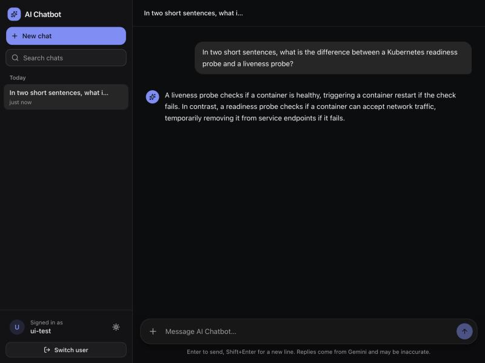
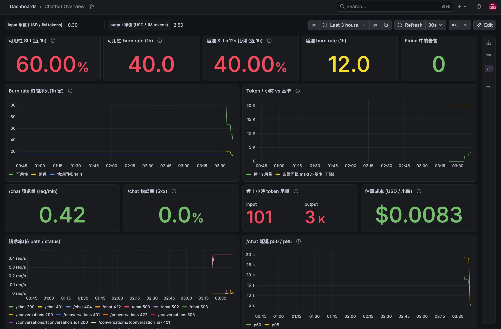
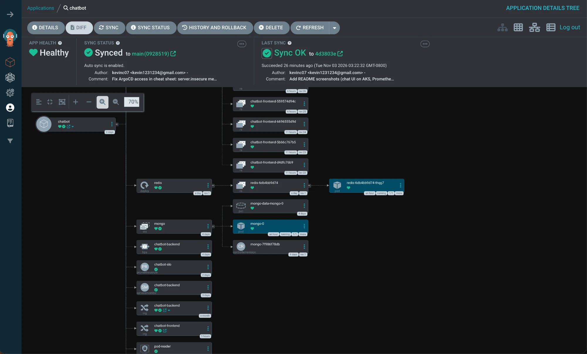
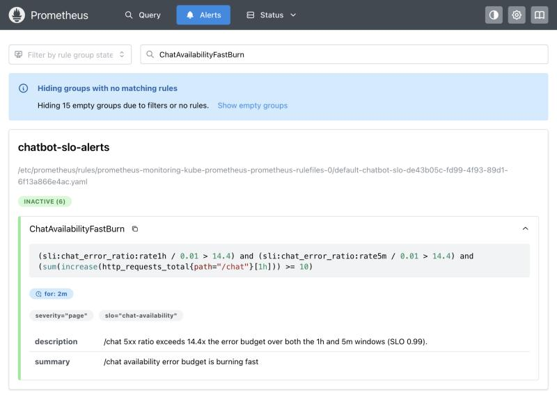
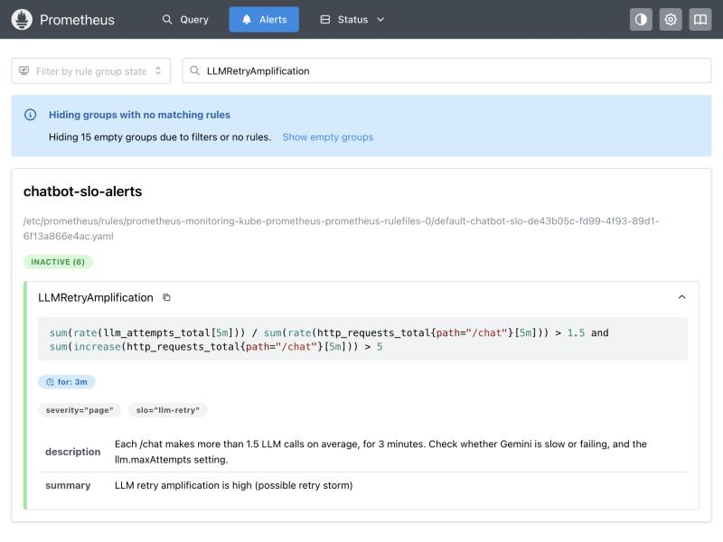

# Cloud-Native LLM Chatbot on Kubernetes

An LLM chat service (FastAPI + LangChain + Google Gemini) running on **Azure Kubernetes Service**.
The chatbot itself is simple on purpose. The project is about **running it like a production service**:
GitOps releases, SLOs with burn-rate alerting, stateless horizontal scaling, cache degradation, and repeatable failure drills.
Every claim below links to a measured result.



## Highlights

| Area | What was built | Evidence |
|---|---|---|
| **GitOps delivery** | `git push` → GitLab CI (test → build arm64 image → write the new image tag back to git) → ArgoCD deploys. A failing test blocks the release. | [e2e-results.md](docs/e2e-results.md): 3 consecutive hands-off deploys with **0 non-200 responses during rollout**. A deliberately failing test produced **no release** after 338 s. |
| **Stateless service + cache** | Conversation history lives in MongoDB (source of truth), with a Redis cache-aside layer. Any replica can continue any conversation. | [day9-memory-bug.md](docs/day9-memory-bug.md) shows the bug before the fix (history lost across 5 replicas). `scripts/memory_test.py` verifies the fix. |
| **SLOs & alerting** | 99% availability, 95% of `/chat` < 12 s. Multi-window burn-rate alerts, a token-cost spike alert, and a retry-amplification alert. | [SLO.md](docs/SLO.md), `mychart/templates/prometheusrule.yaml` |
| **Resilience** | Explicit LLM timeout and capped retries with exponential backoff + jitter. Redis outage degrades to MongoDB instead of failing. | [incident-drill.md](docs/incident-drill.md): retry storm cut from **7.0 → 2.0** LLM calls per request and **47.7 s → 6.5 s** per failing request. Redis outage gave **0 errors**. |
| **Kubernetes ops** | Helm chart with requests/limits, HPA (1–5), readiness/liveness probes, `preStop` graceful shutdown, per-IP rate limiting at the ingress. | `mychart/` |
| **Config automation** | An Ansible playbook validates input, edits the ConfigMap values in git, and lets ArgoCD roll it out (idempotent, `--check --diff` preview). | [ansible/README.md](ansible/README.md) |

## Architecture

```
                       ┌──────────────────── GitLab ─────────────────────┐
  git push ──────────► │ test     pytest (46 tests), helm lint/template  │
                       │ build    arm64 images → GitLab Container Registry│
                       │ release  commit new SHA tag to values.yaml      │
                       └───────────────────────┬─────────────────────────┘
                                               │ git change
                                               ▼
                                 ArgoCD (auto-sync, prune, selfHeal)
                                               │ helm render + apply
 ┌──────────────────────────── AKS ────────────▼─────────────────────────────┐
 │  ingress-nginx  (one host, path routing, per-IP rate limit)               │
 │    ├─ /chat, /conversations, /health → backend  (FastAPI, HPA 1–5)        │
 │    └─ everything else (/)            → frontend (React + nginx, 2 pods)   │
 │       /metrics is not exposed; Prometheus scrapes it inside the cluster   │
 │                                  │              │              │          │
 │                                  ▼              ▼              ▼          │
 │                              MongoDB         Redis        Gemini API     │
 │                         (source of truth) (disposable)    (external)     │
 │                                                                           │
 │  Prometheus ◄─ ServiceMonitor        Grafana (dashboard as ConfigMap)     │
 │  Alertmanager ◄─ PrometheusRule (SLO burn rate, token cost, retries)      │
 └───────────────────────────────────────────────────────────────────────────┘
```

### Life of a `/chat` request

1. The ingress sends the request to any backend replica. Replicas share no memory.
2. The backend checks ownership in MongoDB, then reads history from Redis. On a miss it loads the last 20 messages from MongoDB and refills the cache. If Redis is down it reads MongoDB directly.
3. It calls Gemini with that history. `max_output_tokens` caps the cost of a single call. A 20 s timeout and at most 2 attempts cap the latency and the retry amplification.
4. It writes to MongoDB first and updates Redis only after that succeeds. A MongoDB failure returns **503**, an LLM failure returns **502**, so the two are distinguishable in metrics.
5. The response carries `X-Served-By` and `X-History-Len`. These headers prove that history survives a switch to a different pod.

## Screenshots

**Grafana dashboard** (provisioned from git as a ConfigMap): SLO stats and burn rate on top, then traffic, latency, LLM tokens, estimated cost and cache hit ratio.
This capture was taken shortly after a cluster restart with very little traffic, so a few early errors dominate the 1-hour ratios.
The low-traffic guard (fewer than 10 requests per hour → no alert) is why **Firing alerts = 0** despite the red numbers.



**ArgoCD application tree**: Synced and Healthy, auto-sync on, every resource rendered from the Helm chart in git.



**SLO burn-rate alert rule in Prometheus.** It pages only when the 5xx ratio burns the error budget 14.4x faster than allowed over both the 1h and 5m windows, with a minimum-traffic guard.



**Retry-amplification alert added after the incident drill.**



## Accessing the cluster tools

Grafana, Prometheus, Alertmanager and ArgoCD have no public endpoint. Reach them with `kubectl port-forward`.
Each command blocks, so run each one in its own terminal tab; closing the tab closes the tunnel.
If `kubectl` says `no such host`, the AKS cluster is stopped.

```bash
az aks start -g rg-chatbot-dev -n aks-chatbot-dev    # ~5 min until the node is Ready
az aks get-credentials -g rg-chatbot-dev -n aks-chatbot-dev
kubectl get nodes
```

| Tool | Port-forward | Open | Login |
|---|---|---|---|
| Grafana | `kubectl -n monitoring port-forward svc/monitoring-grafana 3001:80` | http://localhost:3001 → Dashboards → **Chatbot Overview** | `admin` / password below |
| Prometheus | `kubectl -n monitoring port-forward svc/monitoring-kube-prometheus-prometheus 9090:9090` | http://localhost:9090 (Alerts, Query) | none |
| Alertmanager | `kubectl -n monitoring port-forward svc/monitoring-kube-prometheus-alertmanager 9093:9093` | http://localhost:9093 | none |
| ArgoCD | `kubectl -n argocd port-forward svc/argocd-server 8080:80` | **http**://localhost:8080 (not https: the server runs with `server.insecure: true`) | `admin` / password below |

Passwords are stored in Kubernetes Secrets, never in git:

```bash
# Grafana (secret created at install time, see monitoring/README.md)
kubectl -n monitoring get secret grafana-admin -o jsonpath='{.data.admin-password}' | base64 -d; echo

# ArgoCD initial admin password ("not found" means it was rotated or deleted)
kubectl -n argocd get secret argocd-initial-admin-secret -o jsonpath='{.data.password}' | base64 -d; echo
```

**LangSmith** (per-call prompt, response, latency and tokens) is a hosted service, not in the cluster:
sign in at https://smith.langchain.com with the account that owns the API key and open the **`chatbot-aks`** project
(`langsmith.project` in `values.yaml`). Set `langsmith.enabled: false` and push to turn tracing off.

Useful checks:

```bash
kubectl get pods                          # app pods
kubectl -n argocd get app chatbot         # expect Synced / Healthy
kubectl logs deploy/chatbot-backend       # backend logs
kubectl get hpa                           # autoscaling status
```

Stop the cluster when you're done; it bills while running:

```bash
az aks stop -g rg-chatbot-dev -n aks-chatbot-dev
```

## Repository layout

| Path | Contents |
|---|---|
| `chatbot-backend/` | FastAPI service, `chat_store.py` (MongoDB + Redis), `llm_client.py` (timeout/retry policy), `metrics.py`, `tests/` (46 tests) |
| `chatbot-frontend/` | React 19 + Vite + Tailwind v4 UI served by nginx |
| `mychart/` | Helm chart: deployments, HPA, Redis, MongoDB StatefulSet, ingress, ServiceMonitor, PrometheusRule, Grafana dashboard |
| `argocd/` | ArgoCD install values and the `Application` |
| `.gitlab-ci.yml` | test → build → release pipeline |
| `ansible/` | ConfigMap update playbook |
| `monitoring/` | kube-prometheus-stack values and the dashboard generator |
| `scripts/` | `memory_test.py` (multi-replica consistency), `load.sh` (HPA load) |
| `docs/` | SLOs, end-to-end results, incident drill, design trade-offs, interview notes. Original Chinese notes are in `docs/zh/`. |

## Run locally

```bash
cd chatbot-backend
python -m venv venv && source venv/bin/activate
pip install -r requirements-dev.txt
python -m pytest -v      # no Gemini key, MongoDB or Redis needed (fakeredis + fake collection)
```

```bash
# Frontend dev server; Vite proxies /chat, /conversations, /health to VITE_DEV_BACKEND
cd chatbot-frontend && npm install
VITE_DEV_BACKEND=http://localhost:8000 npm run dev
```

The root `docker-compose.yml` is an early local setup. It has no Redis and does not connect the backend to MongoDB,
so the backend falls back to an in-process dict. Use AKS to see the real MongoDB + Redis + multi-replica behaviour.

## Deploy to AKS (summary)

Secrets are created by hand and **never committed**: `chatbot-secret` (Gemini key), `mongo-secret`, `langsmith-secret`,
and `gitlab-registry` (deploy token for pulling images). The GitLab project needs a masked CI variable `CI_PUSH_TOKEN`
(project access token, Maintainer, `write_repository`).

```bash
helm install argocd argo/argo-cd -n argocd --create-namespace -f argocd/values.yaml
kubectl apply -f argocd/application.yaml   # from here on, every change goes through git
```

After that, the day-to-day workflow is just `git push`.

## Design trade-offs and known limitations

[docs/design.md](docs/design.md) explains why each choice was made, what was deliberately left out,
and the gaps that remain. Examples: no real authentication, single-node cluster, no circuit breaker,
and a release-stage race between pipelines.

## Tech stack

Python 3.12 · FastAPI · LangChain · Google Gemini · MongoDB 7 · Redis 7 · React 19 · Vite · Tailwind ·
Docker · Helm · Kubernetes (AKS, arm64) · ingress-nginx · GitLab CI · ArgoCD · Prometheus · Grafana · Alertmanager · Ansible · LangSmith
